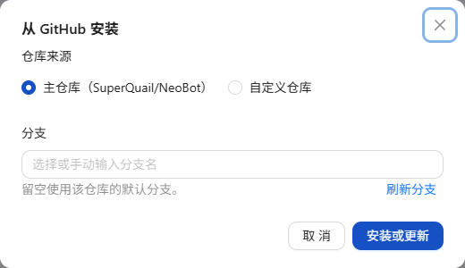

# NeoBot Desktop

[NeoBot](https://github.com/SuperQuail/NeoBot) 的桌面启动器，用图形界面安装、启动和管理机器人。支持切换 NeoBot 版本、查看运行日志，并在兼容的版本中直接绑定 QQ 官方机器人、配置回复模型。

运行所需的 Python 和 uv 由启动器自动下载和管理。

## 下载与准备

当前支持 **Windows x64**。前往 [GitHub Releases](https://github.com/SuperQuail/neobot-desktop/releases)，下载最新版本的 Windows x64 安装包，按发行说明安装后打开 NeoBot Desktop。

开始前请准备：

- 可联网的 Windows 电脑，首次安装需要下载运行环境和 NeoBot。
- [Microsoft Edge WebView2 运行时](https://developer.microsoft.com/microsoft-edge/webview2/)：主流 Windows 电脑通常已自带，仅在启动时提示缺失时需要下载安装。
- 用于绑定 QQ 官方机器人的 QQ 账号，以及模型供应商提供的 API Key。

## 第一次使用

### 安装并启动 NeoBot

1. 打开顶部的「版本」，在「可下载的稳定版」中选择版本，点击「下载」。
2. 等待环境准备完成，在「已安装」中确认启动版本。需要更换时，点击「设为启动版本」。
3. 回到「启动」，点击「启动 NeoBot」。启动进度和运行日志会显示在页面中。

如果「一键准备」提示没有推荐版本，按上面的步骤手动选择即可；出现「安装并启动推荐版本」时，也可以直接使用该入口。

### 连接 QQ 并配置模型

启动后，如果出现「继续快捷配置」，点击进入配置页面：

1. 在「绑定 QQ 官方机器人」中点击「扫码绑定」，用手机 QQ 扫码。已有机器人凭据时，也可以展开「手动配置 AppID / AppSecret」填写并保存。
2. 在「配置回复模型」中填写页面所示供应商对应的 API Key，点击「测试并保存」。更换供应商或模型时，展开「高级：自定义供应商和模型」，填写 HTTPS API 地址和模型名。
3. 如果提示配置需要重启，点击「重启当前版本」。
4. 确认 QQ 显示「已连接」、模型配置已生效后，在手机 QQ 中给机器人发一条消息，检查能否收到回复。

部分旧版 NeoBot 不支持桌面快捷配置。遇到「此版本请使用网页管理完成配置」时，点击「打开网页管理」，在浏览器中继续设置。已配置的网页面板仍沿用该版本自己的监听设置。

## 日常使用

| 页面 | 可以做什么 |
| --- | --- |
| 启动 | 启动或停止 NeoBot，查看 QQ 和模型状态，打开网页管理，查看和复制日志。 |
| 版本 | 下载稳定版或预览版，保留多个已安装版本，选择下次启动的版本，安装或更新 GitHub 分支。 |
| 设置 | 选择下载源，查看和复制当前数据目录路径，开启或关闭版本隔离，查看启动器版本号。 |

切换运行版本时，先在「启动」页停止 NeoBot，再选择其他已安装版本并启动。运行中更改版本选择，只会影响下次启动。

**关闭桌面应用会停止由它启动的 NeoBot。** 如果只是想收起窗口，请使用最小化。

再次打开启动器会显示原来的窗口。窗口已最小化时会自动恢复。

## 版本与数据

默认情况下，各个版本共用数据目录。需要查找配置、插件或备份数据时，在「设置」的「数据目录」中复制完整路径。手动备份前请先停止 NeoBot。

共用数据时，切换到较新的稳定版前会自动备份现有数据；切回旧稳定版需要恢复该版本的兼容快照。恢复后，新版期间新增的聊天、配置和插件数据不会出现在旧版中，当前数据会另存备份。没有兼容快照时，启动器会阻止降级。

### 试用预览版或 GitHub 分支

预览版在「版本」页的「预览版」折叠区中。点击页面右上角的「从 GitHub 安装」，可使用主仓库 `SuperQuail/NeoBot`，也可以在「自定义仓库」中填写公开 fork 的 GitHub 地址或 `owner/repo`。选择或输入分支名后安装，留空会使用该仓库的默认分支。



不同仓库的同名分支可同时安装。要获取某个分支的最新代码，在「已安装」中找到对应版本并点击「更新」。如果它正在运行，先停止它。

分支代码可能包含尚未正式发布的改动，安装时需要能访问 GitHub。预览版和分支默认也会使用共用数据，启动时可能修改配置或数据库，这些修改会影响之后使用同一数据目录的正式版。试用前建议备份数据，或开启「版本隔离」。

### 让不同版本使用独立数据

停止 NeoBot，并等待下载任务结束后，在「设置」→「数据目录」开启「版本隔离」。

- **开启后**：每个版本使用独立目录。现有共用数据不会复制、移动或删除，新目录首次使用需要重新配置。
- **关闭后**：各版本重新使用共用目录；已有的独立数据会保留，但不再使用。

此前预览版迁移留下的独立数据，可以在开启版本隔离后继续使用。

## 遇到问题

| 情况 | 可以尝试的操作 |
| --- | --- |
| 下载慢或安装失败 | 在「设置」→「下载源」切换「官方源」「国内加速」或「自定义」，再重试。发行版安装失败时也可点击「用官方源重试」。国内加速覆盖 Python、uv 和软件包，均使用国内镜像（分支安装仍按分支自带的 uv.lock）。 |
| QQ 二维码过期 | 重新生成二维码，再用手机 QQ 扫码。 |
| QQ 或模型配置已保存，但没有生效 | 查看页面是否提示重启，按提示点击「重启当前版本」。 |
| 机器人启动失败或没有回复 | 查看「启动」页的日志及 QQ、模型状态，点击日志区的「复制」保存当前输出。若提示省略了部分日志，可到网页管理查看详细日志。 |

仍有问题时，可以在本仓库的 [Issues](https://github.com/SuperQuail/neobot-desktop/issues) 中反馈，并附上桌面端版本、NeoBot 版本或分支名、操作步骤和相关错误日志。

## 开发与构建

<details>
<summary>从源码构建或参与开发</summary>

在 Windows x64 上准备 Go 1.26 或更新版本、Node.js 22.12 或更新版本以及 npm。其他环境要求见 [Wails v2 安装文档](https://v2.wails.io/docs/gettingstarted/installation/)。

安装 Wails CLI，获取源码并构建：

```powershell
go install github.com/wailsapp/wails/v2/cmd/wails@v2.17.1
git clone https://github.com/SuperQuail/neobot-desktop.git
cd neobot-desktop
wails build -platform windows/amd64
# 生成的程序位于 build/bin/neobot-desktop.exe
```

首次构建完成后，可在仓库根目录运行：

```powershell
# 启动开发环境
wails dev

# 运行后端测试
go test ./...
```

浏览器调试使用 `http://127.0.0.1:34217`，支持 Go 调用。Vite 开发服务使用 `http://127.0.0.1:5187`，端口被占用时会报错。全新检出后，先完成一次 Wails 构建，再运行 Go 测试，以生成所需的前端嵌入文件。

维护推荐版本时，只有在未安装 Python 和 uv 的 Windows x64 环境中完成正式发行包验收，才设置 `recommendedVersion`。验收应包括安装、QQ 扫码、模型测试、收到首条回复和打开网页面板。

</details>
